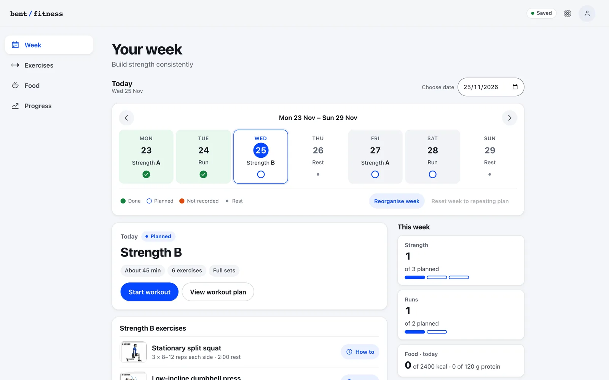

# Fitness

Fitness is a TanStack Start app for planning dumbbell strength sessions and runs, logging workouts with a rest timer, and tracking daily food and bodyweight.

Open [fitness.bent.build](https://fitness.bent.build). Access is restricted to invited accounts, each backed by private per-account cloud storage in a dedicated Postgres database.



- Weekly planner with repeating A/B dumbbell templates, drag-to-reorder week reorganisation and progressive load suggestions.
- Active workout tracking with rest timers, device-resilient drafts, immutable workout history with corrections, and illustrated exercise guides with form cues and YouTube tutorials.
- Daily calorie and protein log, with carbs, fat and fibre for the nutrients you choose to track, one-tap saved meals, seven-day calorie comparison, bodyweight rolling averages and full account data export.
- OAuth and API-key MCP server (`/api/mcp`) so ChatGPT, Claude and other assistants can log meals, bodyweight and runs, set food targets and tracked nutrients, or read training history.
- Apple Health import endpoint (`/api/health/import`) with dedicated import-only iPhone device enrollment and Apple Shortcut support.

## Development

Use Node 24 and Bun 1.4.4. Install dependencies once from the monorepo root, link the `fitness` Vercel project, provision a dedicated Neon development database, then pull the development environment into `.env.local`. Add the Clerk TanStack Start keys and the server-only `FITNESS_ALLOWED_EMAILS` list. Each address must match the account's verified primary email. An empty invitation list denies access.

```sh
bun install --frozen-lockfile
cd apps/fitness
bun run db:migrate
bun run dev
```

[`.env.example`](.env.example) lists the configuration keys. Keep development and production databases and Clerk applications separate. Claim an accountless Clerk development application through Clerk before configuring production. Shared design tokens and controls come from `@bent/design-tokens` and `@bent/ui`; shared schemas, domain rules, progress summaries and exercise guides live in `@bent/fitness-contracts`, which the iPhone app also uses.

The app checks the signed-in account and invitation on every server operation. SQL queries include the authenticated owner ID. Record revisions detect conflicting edits, and per-account request receipts make retries idempotent. Completed workouts retain their exercise prescriptions and results. A correction is a separate record that replaces or hides one completed workout in History, the week view and weight suggestions; the original stays in the account and its export, and removing the correction restores it. Training dates cannot be later than the account's current day in its timezone. Device drafts queue cloud writes and show saving, pending, failure and conflict states. Export pending changes before choosing a cloud version in a conflict.

## Week, exercises, food and progress

The app has four sections: Week, Exercises, Food and Progress. Settings opens from the gear in the header.

### Week and workouts

Week shows the seven days of the selected week. Each day is marked done, planned, not recorded or rest, with its routine or run. Select a day to see what it holds without starting anything: the plan, its exercises with a How to guide for each, and the actions for that day. Start workout begins today's session from Week or from the plan. The week totals compare completed strength sessions and runs with the plan and show the day's food.

Use Reorganise week to rearrange the selected week. Drag a session by its handle to another day, select its handle and then the handle of the day to move it to, or focus the handle and use the up and down arrow keys. Escape puts a selected session back. The sessions in between shift to make room, and Save week stores the new arrangement in one change. Past days and days with recorded or started activity show a lock and stay where they are. The repeating schedule and recorded results stay unchanged, and only days whose session changes get a dated plan. Dated strength plans keep their routine details from the move. Reset week to repeating plan removes that week's adjustments.

Start with the included A/B dumbbell templates. Edit the training days, start date, introduction and routines in Repeating week, reached from Week or Settings. It previews the next two weeks before you save. Strength days take turns through your routines in calendar order from the plan start date, so a missed day keeps its routine. The introduction uses up to two sets per exercise for the configured number of weeks. Each exercise shows how its weight is recorded: a dumbbell or kettlebell weight is for one dumbbell or kettlebell, a barbell weight is the whole bar, a machine or cable weight is what the stack shows, and bodyweight exercises record any weight you add. Band exercises record reps without a weight. Rows and split squats record both sides; planks record seconds. Progression suggestions require all prescribed sets to reach the top of the range with control and at least two reps in reserve. Add confirmed dumbbell sizes in Settings to get suggestions based on available weights.

Open a plan to see last time's results, the suggested load and an estimated duration. A future plan offers Do this workout today, and a past plan offers Log workout for that date or Do this workout today. Starting creates a recoverable draft and starts the elapsed timer.

Typed set values stay on the device until you leave the set, press Done or Skip, leave the page or reopen the draft, then save to your account in one change. Each open tab keeps the fields it typed, so values held in another tab survive a reload. Invalid text stays in its field with a message. Mark each set Done or Skip it to finish; skipped sets do not count towards a weight increase. Rest starts when you mark a set Done, or you can choose a duration to start a new rest interval and skip it from the rest controls. When rest ends, the timer shows Rest done, names the next set, announces it to screen readers and vibrates where the device supports it. Both timers use saved timestamps and continue across navigation and reloads. Every screen, plan and active workout has its own URL and supports browser Back and Forward.

### Exercises, food and progress

Exercises lists each included movement with a picture, how it is measured and the routines that use it. Each guide has setup instructions, form cues, how to record the exercise, your last result, a YouTube tutorial and a six-panel illustration showing the movement from two angles. The same guide opens over a plan or an active workout from How to. Open an illustration at full size to inspect the positions. The illustrations are AI-generated references. Read the written instructions and watch the demonstration before trying a new movement. Start light and stop if a movement hurts.

Food shows the day's calories and protein against your targets, with what is left. Under Settings, choose whether to track carbs, fat and fibre, each with an optional daily target. Tracked nutrients get their own fields when you add food and their own totals on Food. Each total counts the meals that recorded it, and says so when some of the day's meals left it empty. Carbs and fat show what is left or over; fibre shows what is still to go. Saved meals add to the selected day in one tap. Entries can be edited and removed, and a seven-day strip compares daily calories with the target. Below the strip, the selected day's calories, target, what is left or over, and protein show; hover over or focus another day to see its totals there. Screen readers read the same details with each day's link. Move between days with the arrows or the date picker.

Progress counts completed sessions against the plan for recent weeks. Strength cards compare the first and latest best completed set for each exercise, kept separate by reps or seconds and by sides. Bodyweight shows the average of the latest seven weigh-ins and the change from the seven before. Sessions lists completed workouts and runs: correct, remove and restore workouts, and edit or remove runs. A correction editor that finds a newer saved version keeps your typed results and asks whether to load the saved version or save your changes over it. Bodyweight keeps one current value per date; the chart shows the latest 60 recorded dates, a rolling average of up to seven weigh-ins and your highest and lowest values in view. Compare trends over several weeks when adjusting food targets.

The bodyweight and strength charts show a card for the nearest point when you hover over them: a weigh-in with its rolling average and the change since the weigh-in before, or a session's best set with the change since the session before. A line and a highlighted dot mark the point. On a phone, tap a point, or drag sideways across the chart; a vertical drag scrolls the page and keeps the earlier selection. Each chart has a slider for the keyboard and screen readers: Tab to it, move between points with the arrow keys, Home and End, and hear each point's details. Escape hides the card wherever focus is, as does a press outside the chart. The card stays open while the pointer is over it, and a press on the card selects the point beneath it. It stays inside the chart when the window changes size, and shows below the chart when it doesn't fit over it, such as on a narrow strength chart or with larger text.

## Assistants and agents

Fitness runs an MCP server at `/api/mcp` on the app's origin. ChatGPT, Claude and other MCP clients can use it to read and edit food, saved meals, bodyweight and runs, and to read planned and completed training. Tell an assistant what you ate and it logs each item with estimated calories, protein and the nutrients you track, then reports the day's totals. Ask it to change your targets or start tracking fibre, and it updates Settings. Ask it to save a meal and the meal appears in Food for one-tap logging.

| Tool                          | What it does                                                                                                                                                              |
| ----------------------------- | ------------------------------------------------------------------------------------------------------------------------------------------------------------------------- |
| `fitness_get_day`             | One day's meals with IDs, totals and what is left of the targets, the tracked nutrients, weigh-in, plan, workouts, runs                                                   |
| `fitness_get_history`         | Daily calories, protein, tracked nutrients, weigh-ins, workouts and runs for up to 62 days                                                                                |
| `fitness_list_saved_meals`    | Saved meals with IDs, calories, protein, carbs, fat and fibre                                                                                                             |
| `fitness_add_meals`           | Logs one or more meals to a day                                                                                                                                           |
| `fitness_update_meal`         | Changes a meal's name, calories, protein, carbs, fat, fibre or date                                                                                                       |
| `fitness_add_saved_meals`     | Saves one or more meals for one-tap logging; with `fitness:read`, skips meals already saved                                                                               |
| `fitness_update_saved_meal`   | Changes a saved meal's name, calories, protein, carbs, fat or fibre                                                                                                       |
| `fitness_update_food_targets` | Changes the calorie and protein targets, and which of carbs, fat and fibre to track with their daily targets                                                              |
| `fitness_delete_entries`      | Removes meals, saved meals, runs or weigh-ins by ID                                                                                                                       |
| `fitness_log_weight`          | Records the day's bodyweight in kg or lb, replacing an earlier value for that date                                                                                        |
| `fitness_log_run`             | Records a run on today or an earlier date                                                                                                                                 |
| `fitness_list_exercises`      | The exercise catalogue with each exercise's equipment, load type, movement pattern, muscles, level and starting prescription, and the equipment types an account can list |
| `fitness_get_training_plan`   | The goal, repeating week, routines, dumbbell weights, planning profile and any proposal waiting for review                                                                |
| `fitness_propose_plan`        | Proposes a repeating week and routines for the owner to accept in Fitness                                                                                                 |
| `fitness_get_plan_proposal`   | Whether a proposal is pending, accepted, dismissed or replaced                                                                                                            |

Dates use the account timezone, and a tool without a date uses today. Carbs, fat and fibre are optional grams on each meal and saved meal; in an update, `null` removes a value. `trackedNutrients` in day results lists the nutrients the account tracks, `recordedIn` in day and history results counts the day's meals that recorded each one, and a tracked nutrient without a target has `null` as its target and what is left. Read results include each meal, saved meal, run and weigh-in's ID and revision. Updates and deletions send the revision they read, and fail if the entry has changed since. Every change carries a `requestId` chosen by the assistant. Retrying the same call with the same ID returns the first result without saving again, and reusing an ID for different input fails. Retry a saved meal addition with the same access: a retry after the connection gains or loses `fitness:read` fails with the request ID error. Each tool call saves its changes and its result in one transaction, so a failed call saves nothing. Strength workouts are read-only here; record and correct them in the app.

Someone can send the website to their assistant instead: `/llms.txt` explains how to connect and what each permission allows. Once `FITNESS_PLAN_SCOPE=enabled`, it also walks the assistant through setting up training, and, when the endpoint is HTTPS on a public domain name, the signed-out page invites people to send the website to their assistant. For other endpoints the guide points to assistants on the same computer or network. The endpoint in it follows `FITNESS_MCP_URL`; when it isn't a valid endpoint or account services aren't configured, the guide says the connection isn't configured and the signed-out page leaves out the invitation.

To connect an assistant, add `https://fitness.bent.build/api/mcp` as a custom MCP app or connector. The client opens the Fitness sign-in, where you sign in with your invited account and approve access. For scripts and local agents, create an API key under Manage account → API keys, at `/account/api-keys`, and send it as `Authorization: Bearer <key>`. Every request checks the token and the invitation list. OAuth tokens must name the MCP endpoint as their audience. Browser session cookies do not authorize MCP requests.

Access follows the token's scopes. `fitness:read` lists the read tools, `fitness:write` lists the tools that add, change and remove entries, and `fitness:targets` lists `fitness_update_food_targets`, which changes food targets and tracked nutrients, and `fitness:plan` lists the four planning tools and the `set_up_training` prompt. A connection approved before `fitness:targets` existed can't change targets until it is connected again with that scope. Write results include the day's totals, the other saved meals and replaced values only when the token also has `fitness:read`; otherwise they confirm what the call saved. Without `fitness:read`, `fitness_update_food_targets` replies only `{"saved": true}`. Adding saved meals skips a meal already saved with the same name, calories, protein, carbs, fat and fibre when the token has `fitness:read`; without it, the call saves each distinct meal it lists. A token with none of these scopes gets `403 insufficient_scope`. An API key with scopes follows the same rules. An API key without scopes, such as one created under Manage account, has read, write, targets and plan access.

`FITNESS_MCP_URL` sets the MCP endpoint and defaults to `https://fitness.bent.build/api/mcp`. Set it to the local address in development, for example `http://127.0.0.1:3025/api/mcp`. Configure each Clerk instance with these settings:

- Add the MCP endpoint under Agents → MCP servers. Clerk then issues tokens with that audience.
- Create the `fitness:read` and `fitness:write` custom scopes under OAuth applications → Scopes. Describe `fitness:read` on the consent screen as reading meals, saved meals, bodyweight, runs, planned training, workouts with their sets and notes, and your goal and calorie and protein targets. Describe `fitness:write` as adding, changing and removing meals, saved meals, bodyweight and runs. Create `fitness:targets` too, described as changing your daily calorie and protein targets and which of carbs, fat and fibre you track, and `fitness:plan`, described as reading your training plan and proposing new plans for you to accept.
- Turn on dynamic client registration for OAuth applications. Set the scopes allowed for dynamically registered clients to `openid`, `profile`, `email`, `fitness:read`, `fitness:write`, `fitness:targets` and `fitness:plan`.
- Set the OAuth default scopes to `openid`, `profile`, `email`, `fitness:read`, `fitness:write`, `fitness:targets` and `fitness:plan`. Clerk assigns the default scopes to a client that registers without requesting any. ChatGPT registers that way, then requests `openid` because Clerk advertises it.
- `FITNESS_TARGETS_SCOPE` and `FITNESS_PLAN_SCOPE` each add one scope to what the MCP endpoint's sign-in challenge and `/.well-known/oauth-protected-resource` ask for, besides `fitness:read` and `fitness:write`. Set `FITNESS_TARGETS_SCOPE=enabled` once `fitness:targets` is in both the scopes allowed for dynamically registered clients and the default scopes, and `FITNESS_PLAN_SCOPE=enabled` once `fitness:plan` is. Leave a flag unset until then, since a client that asks for a scope Clerk doesn't allow can't sign in.
- A connection keeps the scopes it was approved with. To use plan tools in an assistant connected before `fitness:plan` was offered, remove the connection and connect it again.
- Turn on API keys to create keys for scripts.

`/.well-known/oauth-protected-resource` names the Clerk Frontend API as the authorization server. `/.well-known/oauth-authorization-server` mirrors Clerk's metadata for clients that look it up on the app's origin.

### Browser agents

While you're signed in, the Week, Exercises, Food, Progress and Settings screens register `snapshot`, `query` and `act` tools with the browser through WebMCP (`document.modelContext`), using the [UI SDK](https://ui-sdk.dev) agent bridge. The account pages under `/account` don't. An agent built into the browser finds controls by their accessible names and uses them through the same components a person uses: every button and link, and the fields and choices in Settings, Repeating week, Food, runs, weigh-ins and the date bar, and a history correction's workout date and reason. A step on a control marked `data-agent-confirm`, such as exporting account data or replacing device changes with the cloud version, waits until you choose Allow in the app. The agent can't see or answer that question, and the step is refused while another modal sheet is open. Signing out removes the tools. A call still running then returns no page content, and its remaining steps are refused. Each registration gives the tools names of their own, such as `snapshot_3f9c2a1b44e04d7c9a1f6e2b80d5c317`, so signing in again or reloading the page registers new names. Read the tool list again after either. Browsers without WebMCP get no tools.

The bridge sees only UI SDK components, so Fitness builds its controls from `@ui-sdk/react` through `@bent/ui/sdk/*`. `e2e/agent.spec.ts` checks that every control the bridge lists on eight screens has a name and that each screen's main controls are listed. It also checks that an agent can move between sections, that a marked control waits for the person, and that signing out or an open modal sheet refuses the agent's steps.

### Plans from an assistant

An assistant with `fitness:plan` can set up the owner's strength training. The `set_up_training` prompt starts an interview about goals, experience, days and minutes available, equipment and injuries; the assistant then builds a plan from `fitness_list_exercises` and sends it with `fitness_propose_plan`. A plan names catalogue exercises by `id` with `sets`, `min` and `max` reps (seconds for timed exercises) and optional `rest` in seconds; the catalogue sets each exercise's name, whether it is timed and whether it is done for each side. A proposal also carries a `summary` shown to the owner, the `schedule` from Monday to Sunday, and optionally a `goal` and `dumbbellsKg`. A proposal can also carry a `profile` with experience, session length, limitations, available equipment, kettlebell sizes and weight increments. Accepting the plan saves it, and Settings on the website and Equipment and photos on the iPhone show it.

`fitness_propose_plan` checks the plan as it would apply that day; dated plans from earlier days stay as they are and aren't checked again. The tool refuses fields it doesn't list. A plan with exercises outside the catalogue or rep ranges that aren't whole numbers fails with every problem listed. Warnings, such as an exercise listed twice in a routine or one that needs equipment the profile doesn't list, return with the proposal. The account must already have settings. An account keeps one pending proposal, and a new one replaces it. The reply includes the proposal's ID and the review link, `/proposal`.

A proposal changes nothing until the owner accepts it. The week screen shows a notice while one is pending, and `/proposal` shows the plan with its warnings and lists every other setting it changes next to the current value, including cleared dumbbell sizes. Accepting checks the plan again against the current settings and saves it in the same transaction: it replaces the routines, the repeating week and the dated plans from that day on, and sets the goal and dumbbell weights the plan names. Earlier dated plans, the plan start date, food settings and recorded workouts stay as they are. Dismissing leaves the plan unchanged. A browser agent that presses Accept plan or Dismiss waits until you choose Allow.

## iPhone app API

The bent Fitness iPhone app reads and changes the account through `/api/app`. Each request sends an OAuth access token as `Authorization: Bearer <token>`. The token must name the MCP endpoint as its audience, come from an OAuth application listed in `FITNESS_DEVICE_CLIENT_IDS` and belong to an invited account. Reads need `fitness:read`. Saving a record needs `fitness:read` and `fitness:write`, since a conflict reply carries the current record, and photo changes need `fitness:write`. The routes refuse API keys, device keys, tokens from other OAuth applications and browser cookies.

Each request also sends `X-Fitness-Contract` with the highest version of the records it can read; the current app sends 3. Version 2 adds carbs, fat and fibre on meals and saved meals, and the nutrients settings track. Version 3 adds load types on exercises outside the catalogue and the planning profile in settings: experience, session length, limitations, available equipment, kettlebell sizes and weight increments. A request without the header counts as version 1. Fitness serves requests from a minimum version, currently 3. An older request gets `426` with a message asking to update the app, so an older build stops syncing instead of saving settings without fields it doesn't know. Fitness refuses a save from the app, the website or an assistant that needs a newer version than the minimum, so every stored record stays readable by the builds Fitness serves. `/api/app` replies `422` with the reason.

- `GET /api/app/records` replies `{"owner", "records", "contract"}` with every record in the account and the newest records contract Fitness stores. The app offers nutrient fields only once `contract` is 2 or more; earlier Fitness releases leave it out.
- `POST /api/app/records` saves one change, with the same body and reply as the web app's saves: `{"id", "revision", "operationId", "data"}`, where `data` is `null` to remove the record. The reply is `{"status": "saved", "record"}`, or `{"status": "conflict", "current"}` when the revision is out of date. A repeated `operationId` replays the first reply.
- `GET /api/app/photos` lists equipment photos as `{"photos": [{"id", "name", "type"}]}`. `POST /api/app/photos` saves one with `{"id", "name", "type", "base64"}`; a repeated `id` saves once. `GET /api/app/photos/<id>` replies with the photo, and `DELETE /api/app/photos/<id>` removes it.
- `GET /api/app/export` replies with the same `bent-fitness-v1` download as Settings → Export.

| Reply                    | Cause                                                                                                            |
| ------------------------ | ---------------------------------------------------------------------------------------------------------------- |
| `400 invalid_request`    | The body is not JSON or fails validation; `error` names the first problem                                        |
| `401 unauthorized`       | The token is missing, unknown, expired or issued for another audience. Refresh it or sign in                     |
| `403 client_not_allowed` | The token's OAuth application is not in `FITNESS_DEVICE_CLIENT_IDS`                                              |
| `403 insufficient_scope` | The token lacks a scope the route needs                                                                          |
| `403 not_invited`        | The account's verified primary email is not on the invitation list                                               |
| `413 payload_too_large`  | A record change over 4.5 MB, or a photo upload over 3 MB                                                         |
| `422 invalid_request`    | A record or photo rule refused the change; `error` says which and is safe to show                                |
| `426` (no code)          | The app build is older than the oldest version Fitness serves. Update the app; queued changes stay on the iPhone |
| `503 auth_unavailable`   | Clerk did not answer within 10 seconds, or account services need configuration. Try again shortly                |

## Apple Health

Fitness imports weigh-ins and runs from Apple Health at `https://fitness.bent.build/api/health/import`. A device can send them with its own import-only key, described under [Device keys](#device-keys). An Apple Shortcut or another script can send weigh-ins with an API key you create under Manage account → API keys. Send the key as `Authorization: Bearer <key>`; the key on its own, `Authorization: <key>`, also works, here and on the MCP endpoint. The key needs `fitness:write` access, and a key without scopes has it. The endpoint accepts API keys only and ignores browser cookies.

Each request is one JSON export in the Health Auto Export format:

```json
{
  "data": {
    "metrics": [
      {
        "name": "weight_body_mass",
        "units": "kg",
        "data": [{ "date": "2026-11-20 06:10:00 +1000", "qty": 80.4 }]
      }
    ],
    "workouts": [
      {
        "name": "Running",
        "start": "2026-11-21 06:00:00 +1000",
        "end": "2026-11-21 06:32:00 +1000",
        "duration": 1815,
        "distance": { "qty": 5.2, "units": "km" }
      }
    ]
  }
}
```

- Weigh-ins come from the `weight_body_mass` metric in kg, lb or st. For a date without a weigh-in, Fitness saves the earliest new weigh-in a request sends for it.
- Runs come from workouts whose name contains Run or Running. The duration is in seconds; without one, Fitness uses the time between start and end. Distance can be in km, m, mi or yd. A run without a distance is saved as 0 km.
- Fitness reads timestamps as `yyyy-MM-dd HH:mm:ss +hhmm` or as ISO 8601 with an offset, and dates each entry in the account timezone. Other metrics and workout types are counted and left out.

Fitness decides each Health sample once and remembers the result, so a sync can safely resend days it has already sent. A sample becomes a new entry, or matches one already in Fitness: a weigh-in on the same date, or a run you entered in Fitness on the same date within 5% or 100 m of its distance. Each run you entered matches one Health run at most. Fitness pairs each day's runs to match as many as it can, then with the closest distances. A later sync can revisit an earlier pairing with a run you haven't changed since: the earlier Health run moves to another of your runs, or, if a closer Health run takes its place, Fitness saves it as its own run. Imported runs have the note "Apple Health". Changes and removals you make in Fitness stay in place on later syncs, including after a timezone change. A removed weigh-in keeps its date empty for the samples Fitness had already linked to it.

With `fitness:read` access, the reply has one outcome for each weigh-in date and each distinct run start it can record: `added`, or `kept` with the reason. The `added` counts include an earlier Health run saved because a closer match took its place. Workouts sent twice with the same start count once. Entries dated after today and values outside the app's limits are listed under `skipped` with the reason. A write-only key's reply is `{"received": {"weights": 3, "runs": 1}}`: the weigh-ins and running workouts in its payload, including ones Fitness skips or already has. Send up to 4 MB and 2000 weigh-ins and runs per request. A request with a malformed entry fails with a `400` naming it and saves nothing.

A key that Clerk reports as unknown, revoked or expired fails with `401` and `"code": "key_invalid"`. Fitness confirms that with Clerk directly: a `404` carrying Clerk's `resource_not_found` error gives `401 key_invalid`, and any other reply, such as a gateway's `404`, gives a retryable `503 auth_unavailable`. Other `401` replies have `"code": "unauthorized"`. When Fitness cannot reach Clerk to check the key, the reply is `503` with `"code": "auth_unavailable"`; send the request again later.

### Device keys

A device key has only the `fitness:health:import` scope. It can import weigh-ins and runs, which can move or replace earlier run pairings as described above. Its replies carry the account timezone and one outcome for each sample the request sent. The key cannot read or change anything else, and the MCP endpoint refuses it. It appears under Manage account → API keys as "iPhone sync: " followed by the device name.

Fitness records each enrollment in its database, and only the key recorded on an installation's current enrollment can import. Each installation has one such key. Any other device key, such as one replaced by a later connection or one Clerk created after its enrollment gave up, fails with `401 key_invalid`, and Fitness asks Clerk to revoke it. Each import holds the key's enrollment record until it commits. A disconnect or replacement that starts during an import waits for it, and one that finished first makes the import fail with `401 key_invalid` and save nothing.

Device requests use the same format with stricter rules:

- Every weigh-in in `data` and every workout carries a `ref`: `w:<uuid>` for a weigh-in and `r:<uuid>` for a run, where the UUID is the HealthKit sample's. Fitness compares refs in lower case.
- Only the `weight_body_mass` metric, with its aliases `body_mass` and `weight`, and running workouts are allowed.
- Fitness reads every entry before it decides any outcome. The first ref at an instant, for each type, gets that sample's outcome, even `skipped`; a later ref at the same instant gets `duplicate_in_request`.
- Timestamps are ISO 8601 with seconds and an offset, such as `2026-11-20T06:10:00+10:00`. A run needs a duration or an end time.
- `expectedTimezone`, next to `data`, is the account timezone a backfill grouped its days in. If the account uses another timezone, the request fails with `409`, `"code": "timezone_changed"` and the current `accountTimezone`, and saves nothing.

The whole request fails with `400` and `"code": "invalid_device_request"`, naming the first entry at fault, if any entry has a missing, malformed or repeated ref, a ref prefix for the other type, an unsupported metric or workout, or a value Fitness cannot read, such as a text `qty`, an impossible date or an unknown unit. Nothing is saved. Samples dated after today, or outside the app's limits, get a `skipped` outcome instead.

```json
{
  "kind": "device",
  "accountTimezone": "Australia/Brisbane",
  "outcomes": [
    {
      "ref": "w:6f1c2a7e-3d4b-4c5a-8e9f-0a1b2c3d4e5f",
      "type": "weight",
      "result": "added",
      "code": "new"
    }
  ]
}
```

| `result`  | `code`                 | Meaning                                                      |
| --------- | ---------------------- | ------------------------------------------------------------ |
| `added`   | `new`                  | Fitness saved a new entry                                    |
| `kept`    | `already_imported`     | An earlier sync imported this sample                         |
| `kept`    | `matched_existing`     | The sample matches an entry already in Fitness               |
| `kept`    | `removed_in_fitness`   | The entry this sample became was removed in Fitness          |
| `kept`    | `date_has_weighin`     | The date already has a weigh-in                              |
| `kept`    | `duplicate_in_request` | An earlier ref in this request has the same time and type    |
| `skipped` | `future`               | The sample is dated after today in the account timezone      |
| `skipped` | `out_of_range`         | The weight, duration or distance is outside the app's limits |

Each ref gets exactly one outcome, in request order. Device replies leave out record IDs, earlier match dates and runs the request did not send. Too many samples fail with `400` and `"code": "too_many_samples"`, and a body over 4 MB fails with `413` and `"code": "payload_too_large"`; split the samples across requests.

A device connects and disconnects through these routes. They read only the bearer token and ignore browser cookies.

- `POST /api/health/devices` exchanges a one-time Clerk OAuth access token for a device key. The token must name the MCP endpoint as its audience, carry `fitness:health:enroll`, come from an OAuth application listed in `FITNESS_DEVICE_CLIENT_IDS` and belong to an invited account. The body is `{"installationId": "<uuid>", "deviceName": "<up to 60 characters>", "enrollmentSequence": <whole number from 1 to 2^53 − 1>}`. The app counts its enrollment attempts for each installation and sends the count as `enrollmentSequence`, using a new, higher count for every attempt, including a retry after an uncertain outcome such as a lost reply or a `503`. Of the successful replies it receives, the app keeps the one with the highest count so far, and never replaces a stored key with one from a lower count. A reply from a later attempt can be lost or refused after an earlier attempt's key has already replaced the stored one, so the earlier success is the key that works until a later attempt succeeds. The `201` reply is `{"secret", "accountTimezone", "userId", "email"}`, where `userId` and `email` are the verified account. Connecting an installation again replaces its key. Up to 3 installations can hold keys, and an account can create up to 5 device keys an hour.

  | Reply                        | Meaning                                                                                                       | What to do                                                             |
  | ---------------------------- | ------------------------------------------------------------------------------------------------------------- | ---------------------------------------------------------------------- |
  | `401 unauthorized`           | No bearer, a token that is not an OAuth access token, or one that is unknown, expired or for another audience | Sign in again for a fresh token                                        |
  | `403 insufficient_scope`     | The token lacks `fitness:health:enroll`                                                                       | Approve iPhone sync access when signing in                             |
  | `403 client_not_allowed`     | The token's OAuth application is not in `FITNESS_DEVICE_CLIENT_IDS`                                           | Use a token from an OAuth client listed in `FITNESS_DEVICE_CLIENT_IDS` |
  | `403 not_invited`            | The account's verified primary email is not on the invitation list                                            | Ask the app owner for an invitation                                    |
  | `400 invalid_request`        | The body is not a UUID installation ID, a device name and an enrollment sequence                              | Fix the request; the same token can retry                              |
  | `409 enrollment_token_used`  | This token was already used for an enrollment attempt, which may not have connected a device                  | Sign in again for a fresh token                                        |
  | `409 stale_enrollment`       | The installation already sent this `enrollmentSequence` or a higher one                                       | Start a new attempt with a higher sequence; the same token can retry   |
  | `409 device_limit`           | 3 other installations hold keys                                                                               | Revoke one under Manage account → API keys, then sign in again         |
  | `429 rate_limited`           | 5 keys were created in the last hour, or too many attempts reached Fitness; see `Retry-After`                 | Wait, then retry with the same token                                   |
  | `503 issuance_pending`       | The account was busy, so the token is still unused; see `Retry-After`                                         | Wait, then retry with the same token                                   |
  | `503 auth_unavailable`       | Clerk could not be reached or check the token's signature, or the database failed before the token was used   | Retry later with the same token                                        |
  | `503 issuance_failed`        | Issuing the key failed after the token was used, or may have been used                                        | Sign in again for a fresh token                                        |
  | `503 enrollment_unavailable` | Enrollment is not enabled or configured                                                                       | Try again later                                                        |

- `DELETE /api/health/devices/current` disconnects the device key that sends it and replies `204`. The key stops importing first, then Clerk revokes it. A key that is not its installation's current key, including one already disconnected, fails with `401 key_invalid`; the app can treat that as disconnected. Other keys fail with `403 not_device_key`. This route works whether or not enrollment is enabled, so a device can always disconnect.
- `GET /api/health/devices/ready` replies `200 {"enrollment": "enabled"}` when devices can connect, and `503` with `"code": "enrollment_unavailable"` otherwise. `POST /api/health/devices` replies the same way, before it checks any token. With `?clientId=<OAuth application ID>`, the `200` also means that ID is in `FITNESS_DEVICE_CLIENT_IDS`. Enrollment that is unavailable still gets the `503` first. Then an empty, malformed or repeated `clientId` gets `400` with `"code": "invalid_request"`, and an ID that is not listed gets `403` with `"code": "client_not_allowed"`. Client IDs are public: the app embeds its own.

#### Enrollment limits and lock ordering

Checks run cheapest first, before any Clerk call. Each server accepts about 10 requests a minute to `POST /api/health/devices` and `GET /api/health/devices/ready`, with a burst of 5. Readiness is one database query; each server reuses a ready result for 30 seconds and a not-ready one for 5. All servers together then accept 20 enrollment attempts a minute, counted in Postgres. The count stops at that cap, and a request that arrives once the window is full reads the count without waiting on it, or is refused by its server's memory of the full window. Clerk's SDK fetches its signing keys again for each token whose key ID it does not know, and reports that with the same reason as an outage, so these limits bound those fetches.

Postgres decides which device key can import, so enrollments for one account can run at the same time. Each Clerk call during an enrollment has up to 10 seconds, and listing the account's keys has 10 seconds in all; a list that fails or runs out of time is skipped. The SDK takes no cancellation signal for these calls, so a call that runs out of time can still finish at Clerk, and the rules below make such a late result harmless.

Every database change an enrollment makes, and every disconnect, is one short transaction that locks the account row first, then the enrollment rows it changes. Imports lock the account row before their enrollment row, so the two always take locks in the same order, and an enrollment or disconnect that reaches the account while an import holds it waits for that import to commit. Each statement and lock wait in these transactions has up to 10 seconds. Recording the enrollment, which uses the token, is one of them: if it waits too long, for example behind a long import, it rolls back, the token stays unused, and the reply is `503 issuance_pending`. If its commit reply is lost, the token may have been used, and the reply is `503 issuance_failed`. The current key keeps importing either way until its replacement is swapped in.

Postgres holds both limits. The hourly limit counts each key Clerk created for an hour from its creation, whatever became of its enrollment, and each enrollment whose creation Clerk never confirmed for 24 hours from when it was recorded, or for an hour from its key's creation once Fitness finds that key. Only a create that Clerk's Backend API rejects as an invalid request, with one of the [documented](https://clerk.com/docs/errors/backend-api) parameter or request-body error codes for its status, frees its place; any other failed create, a gateway's 4xx included, keeps it. Installations count while they have an active key or an enrollment still being issued from the last 10 minutes, so two new installations that overlap at the limit cannot both get a key. Before counting installations, Fitness asks Clerk about each active key. An installation whose key Clerk reports revoked or expired, for example under Manage account → API keys, or deleted, frees its place. Deleted means a `404` carrying Clerk's `resource_not_found` error. Any other answer, including a 404 without that error, fails the enrollment with `503 auth_unavailable` and changes nothing. Clerk's key list is used only to find keys to clean up; a key missing from it is never treated as gone.

Each enrollment is recorded, which uses its token and holds its place in the hourly limit, before Fitness changes any key in Clerk. The same transaction checks the token and both limits under the account lock, so two requests with one token, or two that would pass a limit together, take turns, and a refused request leaves its token unused. A token is identified by the ID Clerk verifies for it, so the same token written another way is refused too, and a token without one is refused with `401 unauthorized`. An enrollment still pending after 10 minutes was abandoned: the next enrollment marks it ambiguous, so it can never become current. Clerk then revokes device keys that no enrollment needs: keys without an active enrollment, except one whose enrollment is still pending, which another request may be swapping in. Just before the create, the enrollment must still be pending from the last 10 minutes, and the create must end within 5 minutes of recording, so a request that paused for long creates nothing and replies `503 issuance_failed`. The new key's claims carry the enrollment's ID. When Clerk returns the key, one transaction stops the installation's previous key and makes the new one current, if the enrollment is still pending from the last 10 minutes by the database clock and the installations with current keys stay within the limit, and only after that commits does Clerk revoke the previous key; a revoke that fails is logged, and a later enrollment revokes that key, which can no longer import. When two enrollments for one installation overlap, their swaps take turns, and the later one replaces the earlier one's key. Enrollments for one installation are ordered by their `enrollmentSequence`, the order the app started them in, whatever order they reach Fitness. Before it checks any limit or uses the token, Fitness records the highest sequence each installation has sent, in a short transaction of its own that stays even if the rest of the request is refused. A request whose sequence is no higher gets `409 stale_enrollment`, and its token stays unused; so does one recorded after the app has sent a higher sequence. An enrollment that gets as far as its swap never replaces the current key once the app has sent a higher sequence, even for an attempt that then failed or was refused, nor while an enrollment with the same or a higher sequence has its key or is still being issued: it replies `503 issuance_failed`, and the current key stays. So a successful reply only ever comes from an attempt that swapped before every higher sequence was sent, and a later success replaces it, which is what the app's rule relies on. Enrollments recorded before the sequence existed count lowest. Before replying `201`, an enrollment checks that its key is still the installation's current one; one that was replaced meanwhile replies `503 issuance_failed`. That check is best effort: if its read fails, the key is returned anyway, and a later attempt's successful reply, with its higher count, takes its place in the app. If the create fails or the swap does not happen, the previous key keeps importing and the new key is revoked; the reply is `503 issuance_failed`, and the next attempt needs a fresh sign-in. If the swap's commit reply is lost, Fitness reads the enrollment again on another connection, waiting up to 5 seconds for a commit still in progress: a swap that committed returns the new key, one that did not revokes it, and any other answer leaves both keys for a later enrollment to settle, with `503 issuance_failed`. If Clerk does not confirm the creation, the enrollment is kept as ambiguous, and a key Clerk creates for it later cannot import.

#### Enabling device enrollment

Enrollment needs `FITNESS_DEVICE_ENROLLMENT=enabled`, the comma-separated OAuth application IDs in `FITNESS_DEVICE_CLIENT_IDS`, the Clerk and MCP configuration above with a publishable key Clerk's parser accepts and an `sk_test_` or `sk_live_` secret key, and the `fitness_device_enrollments`, `fitness_device_attempt_windows` and `fitness_device_sequences` tables from `schema.sql` with their columns. The database user needs to read, add, change and remove rows in the first two, to read, add and change rows in `fitness_device_sequences`, and to read, add and lock rows in `fitness_accounts` (`SELECT`, `INSERT` and `UPDATE`, which `SELECT ... FOR UPDATE` needs). Readiness checks the tables and those privileges in one query without writing. Each server reuses a ready result for 30 seconds and a not-ready one for 5, so after a migration readiness can take a few seconds to turn ready, and a change that breaks it can take up to 30 seconds to show. Fitness keeps a SHA-256 digest of each enrollment token there; rows for keys that can no longer import are removed after two days.

Configure each Clerk instance for device enrollment:

- Create the `fitness:health:enroll` custom scope. Describe it on the consent screen as "Let an app on your iPhone import Apple Health weigh-ins and runs into Fitness. Imports can match or re-pair runs you've entered, and the app sees your account timezone and the results of each import."
- Create a public OAuth application named Fitness iOS that uses PKCE. Register one exact redirect URI for each app variant: `build.bent.fitness://oauth` for production and `build.bent.fitness.dev://oauth` for development builds. Give this application `openid`, `offline_access`, `fitness:read`, `fitness:write` and `fitness:health:enroll`, so one sign-in in the app covers the account and Health enrollment. Assign `fitness:health:enroll` to this application only, and leave it out of the dynamic-client and default scopes; `openid` stays available to dynamically registered clients too.
- Issue this application's tokens with the MCP endpoint as their audience.
- Add the application's ID to `FITNESS_DEVICE_CLIENT_IDS`.

### Apple Shortcut for weigh-ins

Shortcuts can read weigh-ins from Health. It cannot read workouts. Health data is available only while the iPhone is unlocked, so schedule the shortcut for a time you usually use the phone.

1. Add Find Health Samples. Shortcuts first asks about Steps; decline it, choose Weight as the type, then allow read access when Health asks. Set Start Date is in the last 7 days, and choose kg in the Unit picker.
2. Add Repeat for Each with the Health Samples. Inside the loop, add Format Date for the sample's Start Date, choose ISO 8601 and turn on Include ISO 8601 Time. Then add a Text action containing `{"date":"<Formatted Date>","qty":<Value>}`. Value must be a plain number with a decimal point, such as `80.4`.
3. After the loop, add Combine Text with the Repeat Results. Choose Custom as the separator and type a comma.
4. Add a Text action containing `{"data":{"metrics":[{"name":"weight_body_mass","units":"kg","data":[<Combined Text>]}]}}`.
5. Add Get Contents of URL. Clear the variable in its URL field and type the import URL. Set Method to POST, add the headers `Authorization: Bearer <key>` and `Content-Type: application/json`, then choose Request Body → File and select the Text from step 4.
6. Run the shortcut once. The first run asks to send Health data to fitness.bent.build; allow it.
7. In Automation, tap +, choose Time of Day and Repeat Every Day, choose Run Immediately, then select the shortcut.

## Privacy policy

`/privacy` describes what the bent Fitness iPhone app reads from Apple Health, where it sends it, what Fitness and the iPhone keep, and how to disconnect or delete data. It renders without signing in, including before account services are configured.

## Equipment photos and exports

Settings accepts up to 20 private JPEG, PNG or WebP equipment photos, each up to 2 MB. The server checks file signatures and ownership, and serves photos with private, no-store headers. Account export includes settings, entries, workout history, corrections, plan proposals with their status and photo bytes. The download starts only after the complete export has loaded. Store exports privately.

Add the site to your home screen through your mobile browser's share menu. The manifest opens it as a standalone app. Reconnect to load cloud data and finish pending saves.

## Feedback toolbar

The Fitness project at `https://toolbar.bent.build` allows the canonical app origin and local development origins. `.feedback-toolbar.json` contains its public installation settings. The shared layout loads the hosted embed. Account data, workout values, food, bodyweight and settings use the toolbar's redaction and privacy attributes.

## Checks and release

```sh
bun run lint
bun run typecheck
bun run test
bun run build
bun run knip
bun run test:browser
```

Run the Bun tests from `apps/fitness` with the repository's pinned Bun 1.4.4 or later. `apps/fitness/bunfig.toml` preloads `tests/preload.ts` for every `bun test` started there, including `fixtures:wire`, and it stops a run on an earlier Bun or a prerelease of 1.4.4, where the integration suite can keep running after a timed-out test. The `test`, `test:integration` and `fixtures:wire` scripts run `bun test` through `scripts/bounded-test.ts`, which uses the same Bun binary and stops the run from outside after 15 minutes: it sends SIGTERM, then SIGKILL 5 seconds later if the tests are still running. Set `FITNESS_TEST_DEADLINE_MS` to a whole number of milliseconds from 1 through 2147483647 to change the limit. Ctrl-C or SIGTERM sent to the runner is passed on to the tests with the same 5-second escalation. `bun test` started directly gets only a best-effort limit from inside the test process. `bun run` starts scripts with the first `bun` on `PATH`, so put the pinned Bun first there. Playwright browser tests and `bun test` started from the monorepo root don't load the preload.

`FITNESS_TEST_DATABASE_URL` enables the Postgres integration tests. The device and wire suites each create a schema of their own, apply `schema.sql` there, point the app's database pool at it through a test-only hook and drop it when they finish, so their pruning and shared counts never reach other data; the database user needs to create schemas, and the readiness test also creates and drops a role. They include the iPhone sync wire fixtures in `tests/fixtures/wire/replies`: real handler replies to synthetic requests with a fixed clock. The test regenerates them and fails when a reply or the file list changes. Run `bun run fixtures:wire` to rewrite them after an intended change. Use a disposable database or the dedicated development database. The tests create unique synthetic account IDs and remove only their own records. One device test reaches the database through a local proxy that uses TLS when the URL's `sslmode` does, and always verifies the certificate and host name, even for `require`, `allow` and `prefer`, which postgres.js leaves unverified. A TLS test database needs both: a certificate that matches the database host, and a trust root for it. Node's own roots serve a public CA; for a private CA, name its file in the URL's `sslrootcert`, which postgres.js reads too, or in `PGSSLROOTCERT`. CI supplies its disposable Postgres service. Public browser checks verify the configuration boundary without provider credentials. A second development server with synthetic Clerk keys checks that the import and device routes answer with their own JSON and skip the session middleware. Authenticated provider checks require a Clerk development application and invited synthetic accounts.

Run the root public-source and workspace checks before publishing. Vercel uses the app directory, Node 24, the pinned Bun bootstrap and the root lockfile. Git-triggered builds are disabled; the repository's `release:vercel` command creates and promotes production candidates with independent review, security checks and `Release qualification`. Configure the dedicated production database and invited accounts before runtime qualification. Apply the schema to that database through the reviewed release procedure. `schema.sql` is additive and safe to apply again. It upgrades an earlier enrollment table in place, adding its later columns and constraints and keeping the token digests already recorded. Apply it before setting `FITNESS_DEVICE_ENROLLMENT=enabled`, since enrollment stays unavailable until its tables exist. Apply it before releasing plan proposals too: proposing, reviewing and accepting plans need its `fitness_plan_proposals` table.
