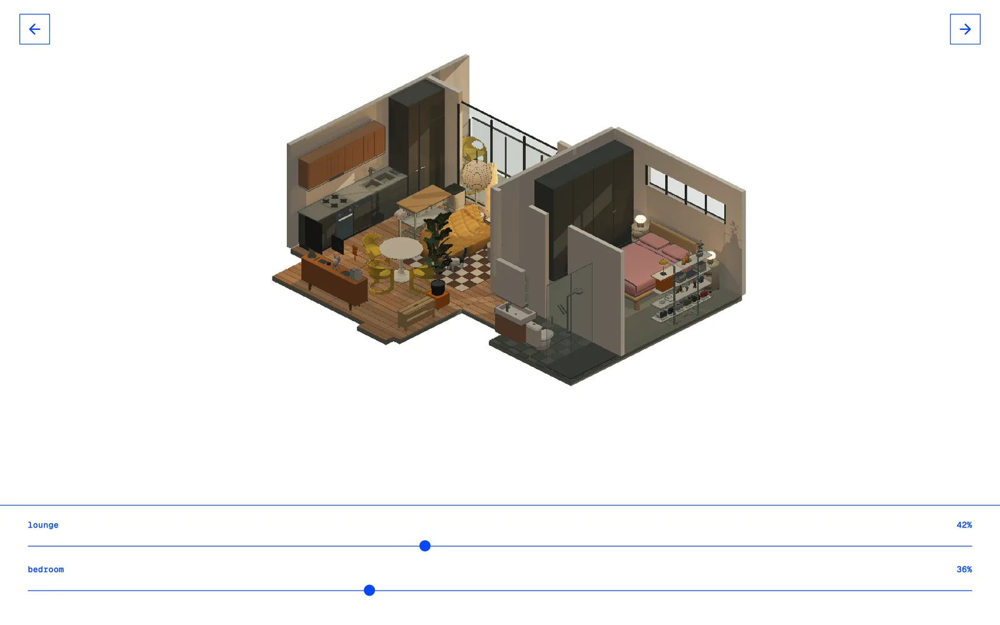

# Home

Home is an interactive isometric 3D apartment viewer with real-time daylight and browser-simulated lighting controls.

Open [home.bent.build](https://home.bent.build). The public viewer is open to everyone; public light sliders simulate lights locally in the browser and cannot operate real devices.



- Renders an isometric 3D apartment with furniture, finishes and two animated cats using Babylon.js, React, vinext and Cloudflare Workers.
- Rotates cleanly across four 90-degree camera angles and calculates sunlight from the current time of day with `suncalc`.
- Shares the same scene engine, models, pets and lighting engine between the public web viewer and the private Home Assistant dashboard card.
- Syncs public furniture positions and finishes through an authenticated outbound publisher into Cloudflare R2, keeping private entity bindings and backups out of public artifacts.

## Development

Use Node 24 and Bun 1.4.4. Install dependencies once from the monorepo root, copy [`.env.example`](.env.example) to `.env`, and fill in numeric synthetic values for the four required location variables (`PUBLIC_HOME_LATITUDE`, `PUBLIC_HOME_LONGITUDE`, `PUBLIC_HOME_BALCONY_BEARING` and `PUBLIC_HOME_ALTITUDE_METRES` — for example `0`, `0`, `90` and `1`; blank values fail startup):

```sh
bun install --frozen-lockfile
cd apps/home
cp .env.example .env
# Set PUBLIC_HOME_LATITUDE, PUBLIC_HOME_LONGITUDE, PUBLIC_HOME_BALCONY_BEARING and PUBLIC_HOME_ALTITUDE_METRES in .env
bun run dev
```

[`.env.example`](.env.example) also documents the private card bindings and release settings.

## Checks

Run checks from `apps/home`:

```sh
bun run typecheck
bun run lint
bun run test
bun run test:integration
bun run build
bun run build:card
bun run test:worker
bun run test:build-privacy
```

`test:worker` starts the built Worker with a temporary local R2 bucket and a synthetic token. It checks rejected and authorized writes, revision conflicts and HTTP cache validation without production access.

## Configuration and privacy

The build requires `PUBLIC_HOME_LATITUDE`, `PUBLIC_HOME_LONGITUDE`, `PUBLIC_HOME_BALCONY_BEARING` and `PUBLIC_HOME_ALTITUDE_METRES`. Set them to the existing deployment's values in protected build configuration for both targets. They are used in client daylight calculations and are visible to site visitors. Keep the owner's exact coordinates in protected configuration. Tests use a synthetic location, and CI must explicitly supply synthetic coordinates when building its test artifacts. Production builds require the existing deployment's coordinates.

The public build always replaces `PUBLIC_HOME_HA_BINDINGS` with `{}`, including inherited operator and `.env` values. `test:build-privacy` builds both targets with a synthetic private binding, checks every public output file for its absence and confirms the private card retains it. Its generated artifacts use synthetic coordinates and must never be deployed.

For the private card, configure `PUBLIC_HOME_HA_BINDINGS` as a JSON object with `television`, `kitchenStrip`, `livingDownlight1`, `livingDownlight2`, `livingDownlight3`, `livingPendant` and `bedroomCeiling`. Supply the installation's configured bindings to enable its controls. Preserve custom lounge role overrides in the private HA integration's `public_lounge_entities` list; they are never exported in public snapshots.

Furniture positions and finishes sync automatically through the authenticated outbound publisher. Private layout backups, source photographs, receipts, purchase provenance, recovered browser state and credentials must remain outside Git and public build artifacts. Catalogue JSON contains only geometry and materials. Blender source files retain their meshes, materials and animations, with personal saved UI paths removed. [`assets/source/third-party/CREDITS.md`](assets/source/third-party/CREDITS.md) records the cat model's CC0 licence.

## Deployment and paired releases

The Worker keeps its existing `home-bent-build` name, `home.bent.build` custom domain and `home-bent-build-layout` R2 binding. Set `CLOUDFLARE_ACCOUNT_ID` through the deployment environment. Keep `PUBLIC_SYNC_TOKEN` in the Worker secret store and the private outbound publisher configuration. The public snapshot endpoint accepts only its existing geometry, finish and lighting-role allowlist. The private publisher remains in `custom_components/apartment_hotel`.

Configure the deployment app root as `apps/home`, install from the repository root and run the app's build. Preserve the existing Worker secrets and R2 bucket. Coordinate a private card release only when shared behavior changes.

Shared feature and model releases must build and verify both targets from the same source. Release the public Worker before the private card introduces new catalogue items. `bun run release:both` performs the existing coordinated checks and release sequence:

- Requires a clean exact-main checkout, authenticated GitHub access for the root release checker and the deployment settings listed in `.env.example`, supplied through an operator-controlled environment.
- `HOME_ASSISTANT_BRIDGE_MODE=ssh` preserves the configured remote bridge. Set it explicitly to `local` when running on that bridge machine; local mode avoids self-SSH and skips copies when staging and bridge paths are the same.
- Distinct checkouts retain their roles and only the approved static assets, publisher and card resource URL change. The final Home Assistant hop always uses the existing root SSH target, owner-only identity and known-host trust. Tilde identity paths expand on the actual bridge, never inside quoted shell text.
- A read-only SSH/HTTP preflight must succeed before public deployment or private staging. The wrapper rechecks the authoritative Quality run immediately before public deployment and again before private preparation.
- `/api/release` must report the exact source revision and `/api/layout` must retain schema 1 before the private card advances. Builds pin `HOME_RELEASE_SHA` to the current Git commit; a mismatched override fails. Keep private machine names, addresses, keys and layout backups outside this repository.
