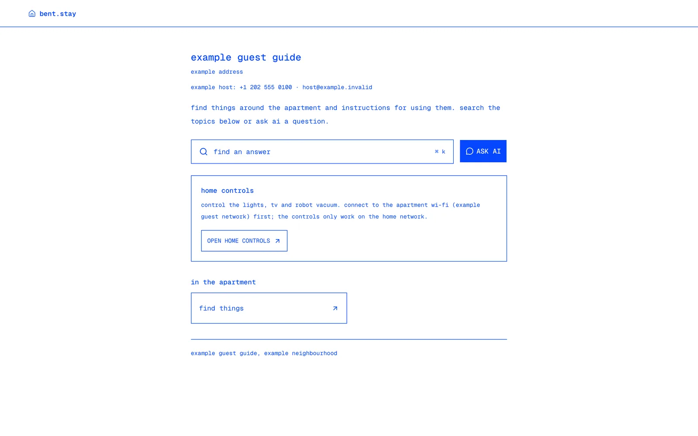

# Stay

Stay is an authenticated apartment guide for invited guests, with owner-managed content, AI answers grounded in the guide and appliance manuals, Wi-Fi QR access and limited local home controls.

Open [stay.bent.build](https://stay.bent.build). Access is restricted to invited guests and the verified host account.



- Searchable house guide with client-side fuzzy search, authenticated photos and an evacuation view.
- AI assistant that answers guest questions from the published guide and official appliance manuals.
- Wi-Fi password and QR code, plus controls for the apartment lights, TV and robot vacuum routed through a limited local server bridge.
- Host editor (`/edit`) built with TipTap for managing drafts and published content, alongside guest invitation controls (`/guests`) restricted to the verified `OWNER_EMAIL`.

## Development

Use Node 24 and Bun 1.4.4. Install dependencies once from the monorepo root, then configure `.env.local` using [`.env.example`](.env.example):

```sh
bun install --frozen-lockfile
cd apps/stay
cp .env.example .env.local
bun run dev
```

Local and preview runs use synthetic fixtures while preserving the same Clerk authentication and authorization boundaries as production.

## Checks

Run checks from `apps/stay`:

```sh
bun run lint
bun run format:check
bun run typecheck
bun run test
bun run knip
bun run build
```

`bun run test` covers chat grounding, manual search, guide loading, CMS workflows, rich-text sanitization, home controls and privacy checks.

## Private content and deployment

The public repository contains synthetic local and preview content. Production reads from the existing private Vercel Blob store. Unavailable storage or content stops the request; fixtures are restricted to local and preview use. Keep the old deployment serving guests until the private content and asset preparation below is verified.

Set the Clerk keys, verified `OWNER_EMAIL`, AI configuration and protected home bridge configuration in the existing deployment environment. Connect the existing private Blob store using `BLOB_STORE_ID` with Vercel OIDC or `BLOB_READ_WRITE_TOKEN`. Keep these values in server-only variables. The transfer command stores the original network URL in private `guide/home-controls.json`, resolved only after authorization through `/home-controls`. `HOME_CONTROLS_URL` can override that private configuration when explicitly set. Keep the controls bridge's Home Assistant token on its host.

From an already authenticated protected environment, prepare the private objects using the original private source archive and an outside-repository backup directory:

```sh
bun --conditions=react-server scripts/prepare-private-content.ts --source-root /path/to/private/original --backup-dir /path/to/private/backup
bun --conditions=react-server scripts/prepare-private-content.ts --source-root /path/to/private/original --backup-dir /path/to/private/backup --apply
```

The first command reads storage and writes only a private backup of existing CMS state. The second uploads missing objects with overwrite protection and verifies each object's SHA-256, including private home-controls configuration. Existing drafts and published documents remain unchanged. Different existing asset bytes block preparation. Keep the original source, local controls environment and photographs intact outside this repository.

Before switching deployment source, verify existing published and draft content, every authenticated photo and evacuation route, invitation restrictions, chat, Wi-Fi access and home controls against the existing app. Content transfer verification and domain cutover authorization are separate requirements from a successful source build.
