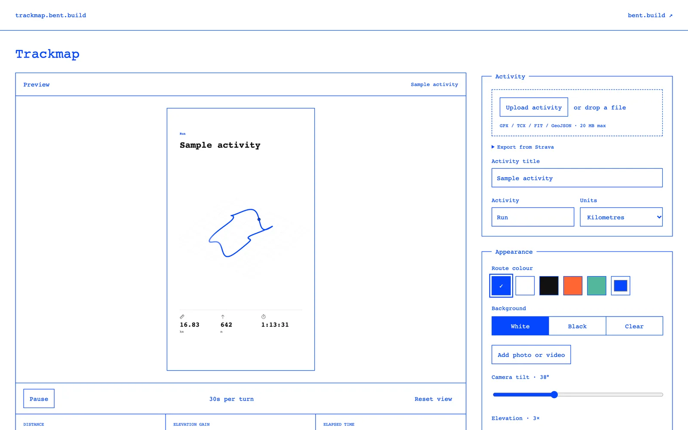

# Trackmap

Trackmap turns a GPS activity file into a rotating 3D route card in your browser.

Open [trackmap.bent.build](https://trackmap.bent.build). No account is required, and a synthetic sample route is loaded so you can try the controls immediately.



- Parses GPX, TCX, FIT and GeoJSON files up to 20 MB and 150,000 GPS points directly in the browser.
- Projects coordinates and elevation into a rotating 3D route with camera tilt, elevation exaggeration, route endpoint trimming, `km`/`mi` units, colour presets and optional title and stat overlays.
- Exports 9:16 Story (`1080 × 1920`) or 1:1 square (`1080 × 1080`) H.264 MP4 videos at 30 fps over a plain background or a local photo or video.
- Exports 1080 px PNG images and 540 px looping GIFs, with optional transparent backgrounds for layering in an editor.
- Activity files and background media stay on your device; nothing is uploaded to a server.

## Development

Use Node 24 and Bun 1.4.4. Install dependencies once from the monorepo root, then start the Vite dev server:

```sh
bun install --frozen-lockfile
bun run dev --filter=@bent/trackmap
```

Or run commands directly from `apps/trackmap`:

```sh
cd apps/trackmap
bun run dev
```

Trackmap is built with React, Vite, Canvas 2D, `mediabunny`, `gifenc`, `fit-file-parser` and `saxes`, using shared tokens from `@bent/design-tokens` and controls from `@bent/ui`. H.264 MP4 export uses WebCodecs AVC encoding in browsers that support it.

## Checks

Run the workspace checks from `apps/trackmap`:

```sh
bun run lint
bun run typecheck
bun run test
bun run knip
bun run build
bun run test:browser
```

`test:browser` runs the Playwright end-to-end suite against the built app.

## Deployment

Trackmap deploys as a static Vite build to Vercel from `apps/trackmap`, using Node 24, the pinned Bun bootstrap and the root lockfile. `vercel.json` sets a strict Content Security Policy and disables geolocation, camera and microphone access.

Assigning `trackmap.bent.build` uses the shared `bun run release:vercel` route from the repository root and requires the exact-head `Release qualification` production Deployment Check.
