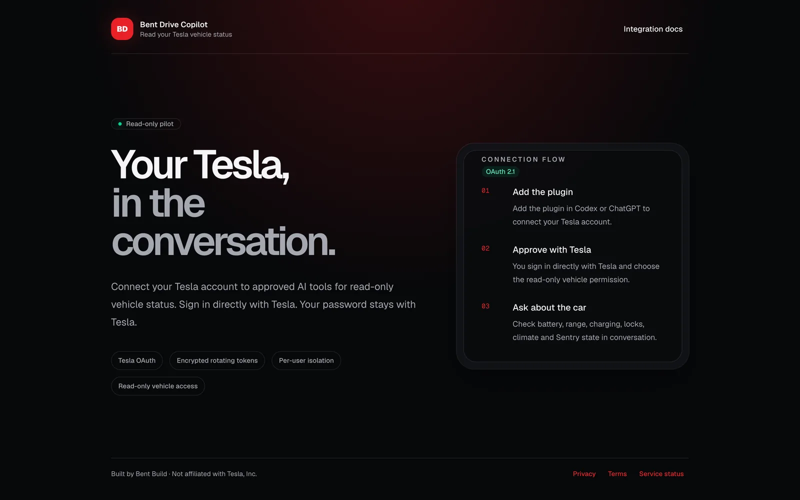

# Drive

Bent Drive Copilot is a read-only Tesla MCP server for ChatGPT and Codex.

Open [drive.bent.build](https://drive.bent.build) for the overview and [drive.bent.build/docs](https://drive.bent.build/docs) for the connection guide. Connecting requires an invited GitHub account and a Tesla account.



- Exposes an OAuth 2.1 MCP endpoint at `https://drive.bent.build/mcp` with dynamic client registration and S256 PKCE.
- Provides two read-only tools: `tesla_list_vehicles` and `tesla_get_vehicle_status` (battery, estimated range, charging, locks, cabin climate and Sentry state).
- Requests only Tesla's read-only vehicle scope (`openid offline_access vehicle_device_data`); it never requests command scopes and cannot unlock, start or control a vehicle.
- Encrypts rotating tokens per user in Postgres. Invited GitHub accounts bind to immutable provider user IDs after the first accepted login, and revoking an invitation disables access and active MCP tokens.

## Workspace layout

| Path | Package | Role |
| --- | --- | --- |
| [`apps/web`](apps/web/README.md) | `@bent-build/drive-copilot-web` | Next.js web service for `drive.bent.build` and `tesla.bent.build`, handling Clerk/GitHub sign-in, Tesla OAuth, Postgres storage and `/mcp` |
| `packages/tesla-contracts` | `@bent-build/tesla-contracts` | Shared Zod schemas and TypeScript contracts |
| [`plugins/tesla-bridge`](plugins/tesla-bridge/README.md) | `@tesla-bridge/mcp-server` | Codex plugin (`tesla-copilot` skill and `.mcp.json`) plus local stdio and HTTP MCP server tooling |
| `tooling/eslint`, `tooling/typescript` | `@bent-build/eslint-config`, `@bent-build/tsconfig` | Shared lint and TypeScript configuration |

## Development

Use Node 24 and Bun 1.4.4. Install dependencies once from the monorepo root, then configure `apps/web/.env.local` using [`apps/web/.env.example`](apps/web/.env.example):

```sh
bun install --frozen-lockfile
cd products/drive/apps/web
cp .env.example .env.local
bun run db:migrate
bun run dev
```

Set both `BENT_DRIVE_ADMIN_GITHUB_USERS` and `BENT_DRIVE_ALLOWED_GITHUB_USERS` explicitly in your environment, alongside Postgres (`DATABASE_URL`), `TOKEN_ENCRYPTION_KEY`, Clerk keys and Tesla Fleet API credentials. Keep all credentials, encryption keys, account data, tokens and vehicle records outside Git.

## Checks

Run checks for the web service and its supporting packages from their directories or via Turbo from the monorepo root:

```sh
bun run --cwd products/drive/apps/web lint
bun run --cwd products/drive/apps/web typecheck
bun run --cwd products/drive/apps/web test
bun run --cwd products/drive/apps/web build
bun run --cwd products/drive/packages/tesla-contracts test
bun run --cwd products/drive/plugins/tesla-bridge test
bun run --cwd products/drive knip
```

## Deployment

The web service deploys to Vercel from `products/drive/apps/web` using Node 24, the pinned Bun bootstrap and the root lockfile. Preserve the existing Vercel project environment, database, public Tesla verification key and OAuth callbacks. Production releases use the root `bun run release:vercel` workflow with `Release qualification`.
